# PressyCMS

**Not another CMS.** PressyCMS looks and feels like WordPress and lets you build pages from blocks like Elementor. There's no database, no login page and no plugin code running on your server.

> Write a markdown file → push to GitHub → your site updates.

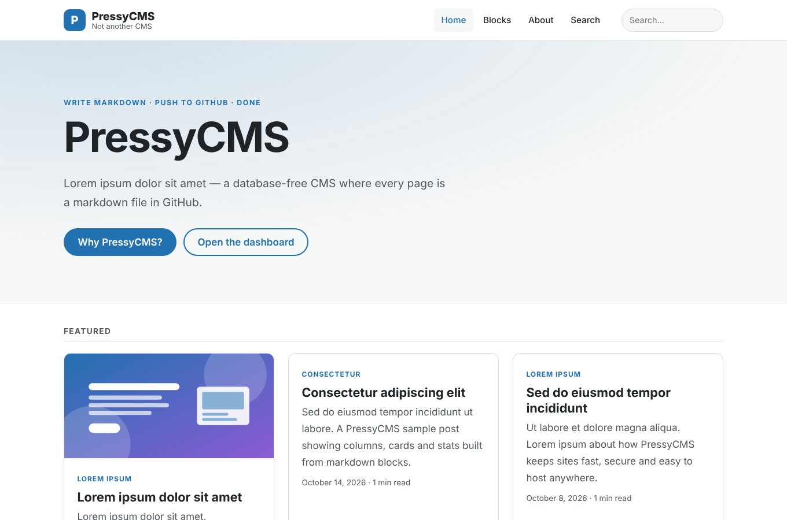

- 🗄️ **No database.** Every post and page is a markdown file in `content/`. Git is your revision history, backup and editorial workflow.
- 🧱 **Elementor-style blocks in markdown.** Hero, columns, cards, stats, callouts, FAQ, testimonials and more. Drag them in from the visual editor or type `:::callout`.
- 🎨 **Themes and page templates.** Two themes included; any post can pick `template: landing`.
- 🔌 **Plugins with permissions.** WordPress-style actions and filters. Plugins run at build time only and get only the APIs they declare.
- 🔒 **Secure by default.** Static output, strict CSP, raw HTML escaped, URL schemes filtered, no cookies or third-party requests.
- 📈 **SEO built in.** Sitemap, robots.txt, RSS, canonical URLs, Open Graph, JSON-LD (BlogPosting, Breadcrumbs, FAQPage, WebSite), `llms.txt`, a content linter, and builds that fail on broken links.
- 🤖 **Agent-ready (Claude).** A bundled MCP server, `@claude` GitHub workflow, Claude skills, an "Ask Claude" button in the editor, and machine-readable twins of every page.

## Quick start

```bash
git clone https://github.com/noisyloop/PressyCMS && cd PressyCMS
npm install
npm run dev            # http://localhost:4321  ·  dashboard at /admin/
```

Create a post:

```bash
npx pressy new "Lorem ipsum dolor sit amet"
# → content/posts/lorem-ipsum-dolor-sit-amet.md  →  /lorem-ipsum-dolor-sit-amet/
```

```markdown
---
title: "Lorem ipsum dolor sit amet"
description: "A 70–160 character summary used for search results and cards."
date: 2026-10-23
category: Lorem Ipsum
tags: [PressyCMS, Blocks]
---

Lorem ipsum dolor sit amet, consectetur adipiscing elit.

## PressyCMS: a section

:::callout type="tip" title="Lorem ipsum"
Dolor sit amet.
:::
```

Push it and you're done. CI runs tests, the content linter and the build, and your host deploys `dist/`.

## Screenshots

### Posts, pages and blocks

| Post (Pressy theme) | Landing page built from blocks |
|---|---|
| 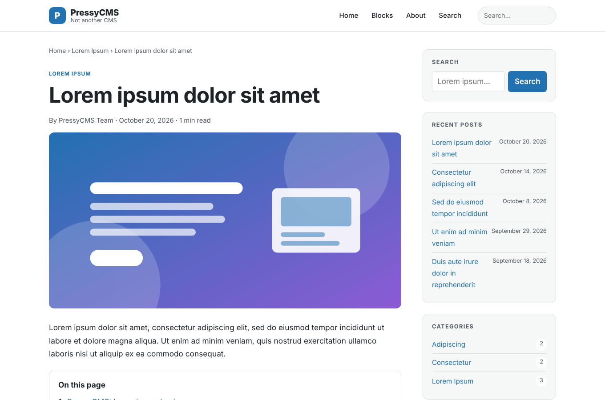 | 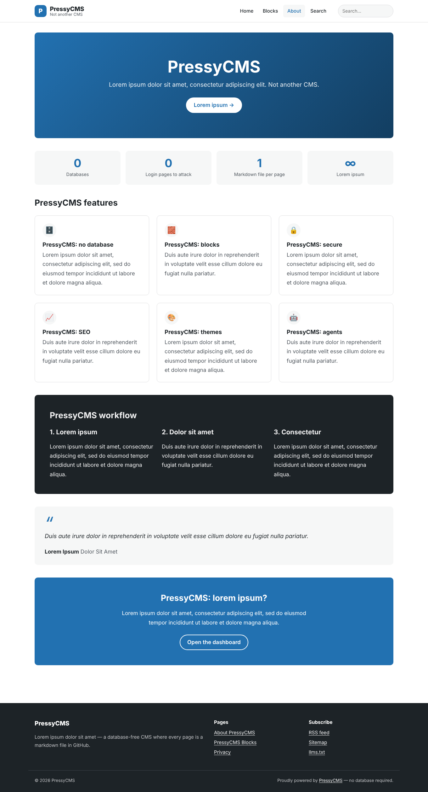 |

| Every block in one page | Mobile |
|---|---|
| 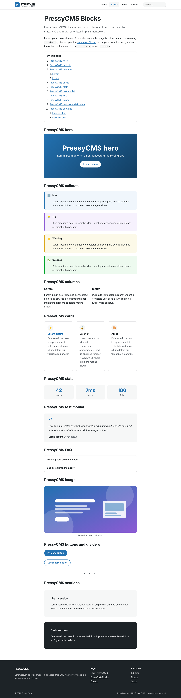 | 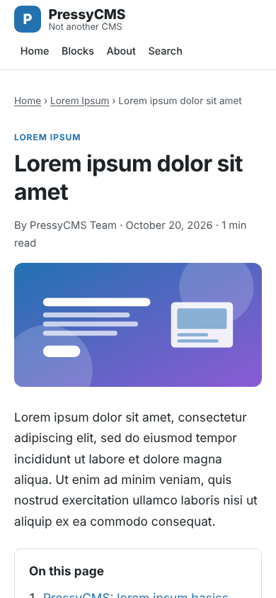 |

### The dashboard (WordPress-style, zero backend)

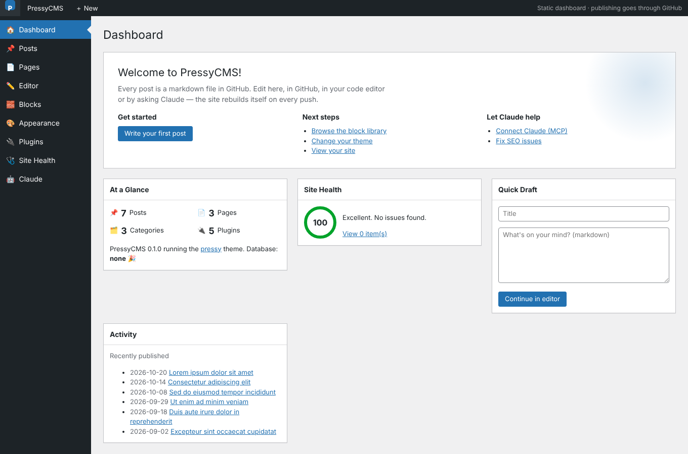

**Elementor-inspired editor.** Drag blocks from the left panel into the markdown, preview live, check SEO as you type, then **Publish via GitHub**, download the `.md`, or hand the draft to Claude.

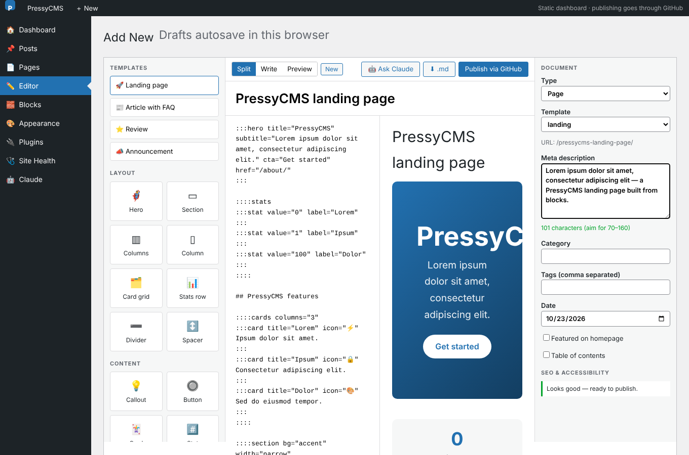

| Posts | Themes |
|---|---|
| 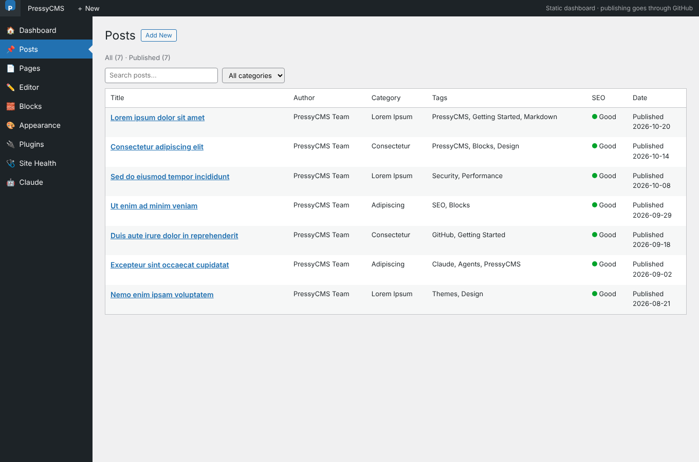 | 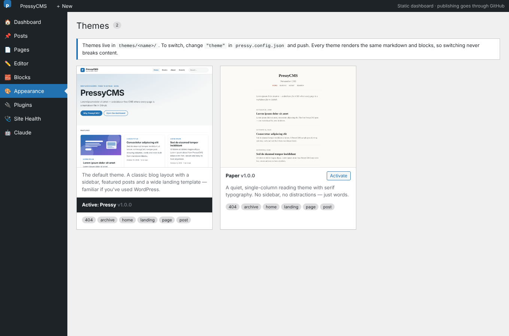 |

| Plugins (with permissions) | Claude |
|---|---|
| 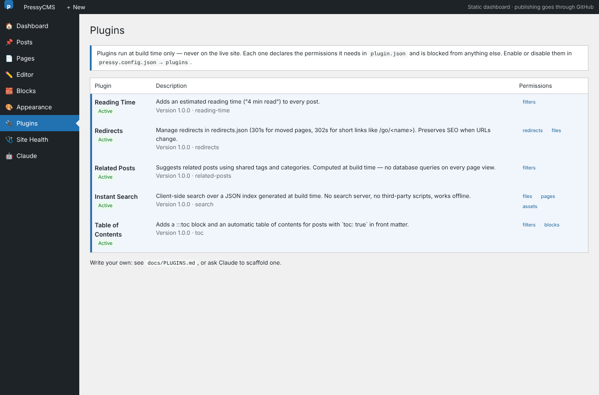 | 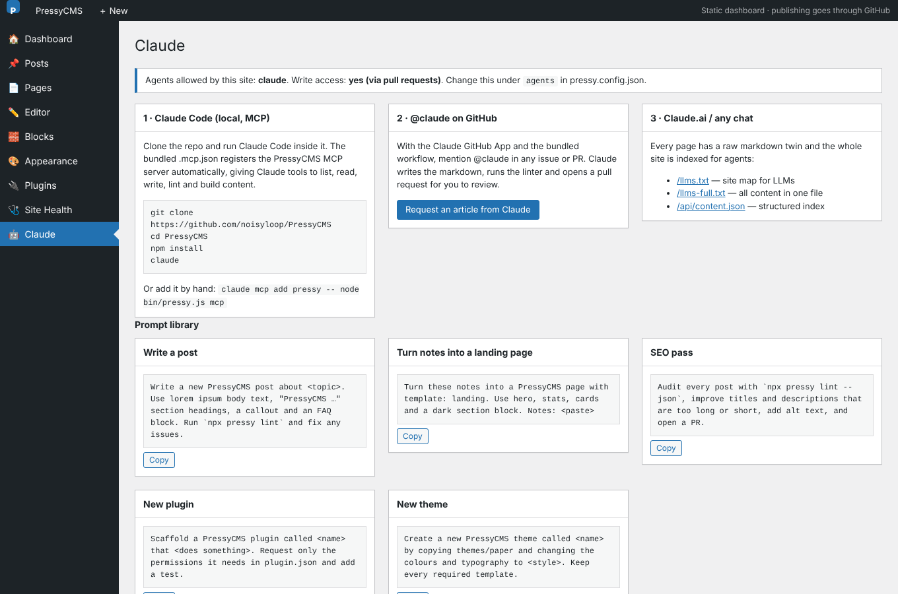 |

### Same content, different theme (Paper)

| Home | Post |
|---|---|
| 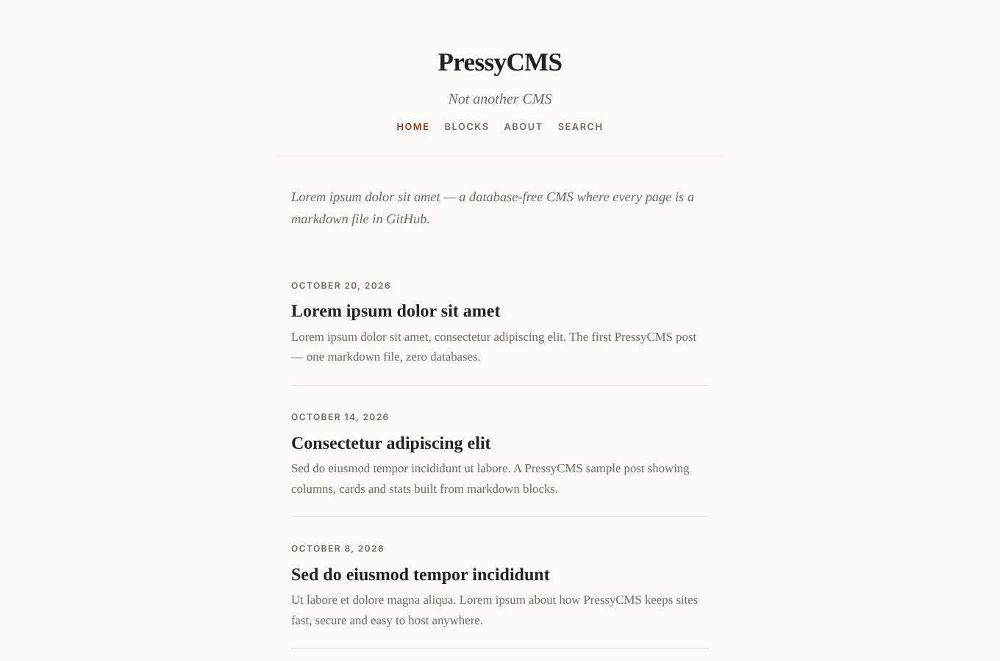 | 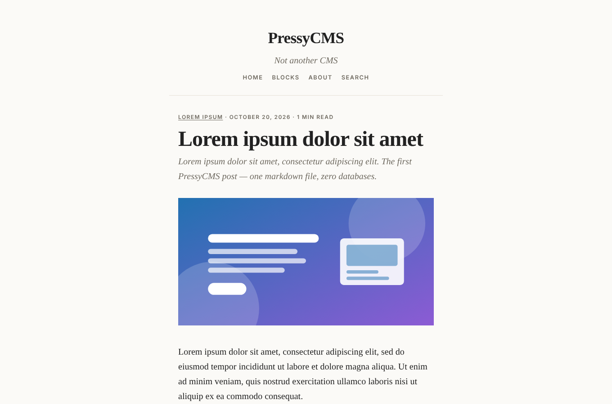 |

### Instant search (no server)

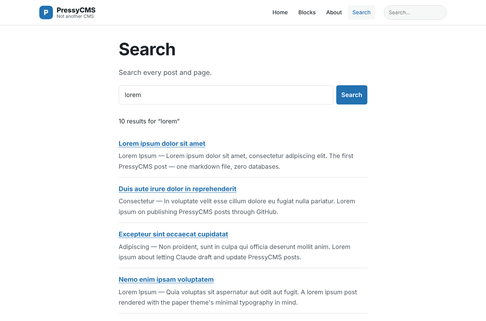

## How it works

```
content/posts/*.md ─┐
content/pages/*.md ─┼─▶  pressy build  ─▶  dist/  ─▶  any static host
themes/<active>/   ─┤     (plugins run         (HTML, sitemap, RSS,
plugins/<enabled>/ ─┘      here, then stop)     _headers, _redirects)
```

| Path | Purpose |
|---|---|
| `content/` | Your posts and pages (markdown + YAML front matter) |
| `pressy.config.json` | Site title, URL, nav, theme, plugins, agent policy |
| `themes/` | `pressy` (classic blog with sidebar) and `paper` (minimal serif) |
| `plugins/` | `reading-time`, `toc`, `related-posts`, `search`, `redirects` |
| `src/` | The engine (~2,000 lines incl. the admin, two dependencies) |
| `static/` | Files copied as-is (favicon, media, block CSS) |

### Commands

| Command | Does |
|---|---|
| `npm run dev` | Dev server, rebuilds on save, includes drafts |
| `npm run build` | Production build into `dist/` |
| `npm run lint` | SEO / accessibility / block checks (`-- --json` for agents) |
| `npm test` | Engine tests (security, templates, MCP, every theme builds) |
| `npx pressy new "Title" [--page] [--template landing]` | Scaffold a post or page |
| `npx pressy serve --theme paper` | Preview another theme without changing config |
| `npx pressy themes \| plugins \| blocks` | List what's installed |
| `npx pressy mcp` | MCP server for Claude (stdio) |
| `npm run screenshots` | Regenerate these screenshots (needs Playwright) |

## Contributing articles via GitHub

Authors don't need to install anything:

1. Open `/admin/#new` on the live site, write the post with the block editor, and click **Publish via GitHub**. GitHub opens with the file pre-filled.
2. Or open **Add file → Create new file** in `content/posts/` on GitHub.
3. Or open an **Article request** issue and let Claude draft it.

Each route ends in a pull request. CI lints and builds it, a maintainer reviews and merges, and the site deploys.

## Claude integration

Claude is currently the only agent allowed (`"agents": { "allowed": ["claude"] }`).

- **Claude Code:** run `claude` in the repo. `.mcp.json` connects the PressyCMS MCP server with typed tools (`create_content`, `lint_content`, `build_site`…) confined to `content/`, with no delete tool. `CLAUDE.md` and `.claude/skills/` teach it the conventions.
- **GitHub:** mention `@claude` or label an issue `article-request`. Claude writes the post, lints and builds it, and opens a PR.
- **Dashboard:** "Ask Claude" in the editor, a one-click fix-it request in Site Health, and a prompt library.
- **Any LLM:** `/llms.txt`, `/llms-full.txt`, `/api/content.json` and an `index.md` twin of every page.

See [docs/AGENTS.md](docs/AGENTS.md).

## Why not WordPress?

We went through the most common WordPress complaints (plugin vulnerabilities, login brute-forcing, the update treadmill, database bloat, page-builder lock-in, slow pages, SEO-by-plugin) and designed against each one. The full analysis, including the trade-offs we accept, is in **[docs/WORDPRESS.md](docs/WORDPRESS.md)**.

## Deploying

The output is plain static files, so it runs anywhere:

- **Cloudflare Pages:** build `npm run build`, output `dist`. `_headers` and `_redirects` are honoured.
- **Cloudflare Workers:** `npm run build && npx wrangler deploy` (see `wrangler.jsonc`).
- **Netlify:** same build settings; same `_headers`/`_redirects` format.
- **GitHub Pages / S3 / any web server:** upload `dist/`. Redirects fall back to meta-refresh pages; set security headers in your server config.

Set `site.url` in `pressy.config.json` to your real domain so canonical URLs and the sitemap are correct.

## Docs

[Blocks](docs/BLOCKS.md) · [Themes](docs/THEMES.md) · [Plugins](docs/PLUGINS.md) · [Agents](docs/AGENTS.md) · [Security](docs/SECURITY.md) · [WordPress comparison](docs/WORDPRESS.md)

## Credits

PressyCMS grew out of the single-file markdown site generator behind [lateralmoves.net](https://github.com/noisyloop/movinglaterally): one markdown file per article, no database, Cloudflare-ready output.

MIT licensed.
